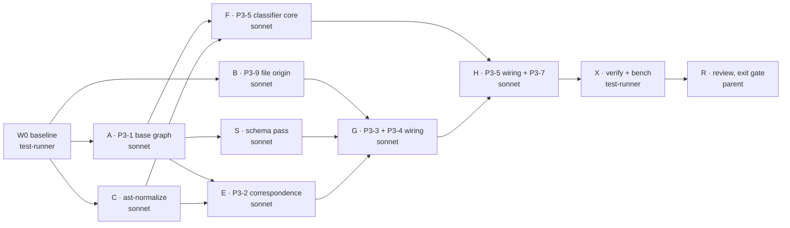

# Phase 3 Execution Plan · Two-Snapshot Graph and Change Taxonomy

Spec: Obsidian `03 Project Docs/Implementation Roadmap/Phase 3 - Two-Snapshot Graph and Change Taxonomy.md`
ClickUp list: `Phase 3 · Two-snapshot and taxonomy` (1200440000083882) · Branch: `phase-03`

**In scope:** P3-1, P3-2, P3-3, P3-4, P3-5, P3-7, P3-9
**Out of scope (deferred):** P3-6 (type/interface entities), P3-8 (full semantic property suite). The
format-invariance property test stays in P3-7.

---

## 1. Decisions fixed before any worker starts

Workers must follow these and must not reopen them. If a decision blocks a worker, it returns a question.

| # | Decision |
|---|---|
| D1 | All Phase 3 behaviour is **extended engine only**. The legacy engine and the legacy goldens do not change. |
| D2 | Base content is read through a **separate** `ts.CompilerHost` (`baseline-host.ts`) backed by `repo.getBaselineSource`. It never calls `snapshot.readFile` and never writes to `reads` in `source-snapshot.ts:14`. |
| D3 | Seam for AST data: `extractTechnicalGraph` gets an optional `onEntityNode?(entity: Entity, node: ts.Node, sourceFile: ts.SourceFile)` callback. Fingerprints are computed inside that callback, so the base `Program` can be released after extraction. No `ts.Node` outlives its extraction. |
| D4 | One shared module, `ast-normalize.ts`, is the only place that turns AST into comparable strings. P3-2 and P3-5 both use it. |
| D5 | All schema changes go in **one schema pass** (task S). They are optional fields under schema `2.1`, with no version bump. No other task edits `contracts.ts` types, `evidence.schema.json` or `validator.ts`. |
| D6 | When correspondence is ambiguous, the entity is treated as `deleted` + `added`, which gives more impact, never less. It also emits an `AMBIGUOUS_CORRESPONDENCE` warning diagnostic. Renames are claimed only for a unique 1-to-1 match. |
| D7 | The impact of a deleted entity is computed on the **base** graph's `reverseAdjacency` (callers as they were). |
| D8 | Edge keys are `from|type|to`, the same shape as `technical-graph.ts:217`. Base IDs are mapped through the correspondence (renamed → head ID) before the set difference. |
| D9 | When the classifier is unsure, it escalates to the more impactful class. |
| D10 | All new arrays and maps that reach evidence are sorted, for determinism (`deterministic.ts`). |
| D11 | Base extraction runs only when at least one analyzable file changed. Otherwise the base graph is empty and no base work is done. |

## 2. Code map (verified 2026-10-28 on `f6de7b5`)

| Concern | Location |
|---|---|
| Pipeline | `packages/analyzer/src/analyze.ts:26-134` (head extraction at :44-54, changed-file filter at :74-80, `findChangedEntities` at :81-86, impacts at :89-96) |
| Head snapshot + identity | `src/source-snapshot.ts:12-129` (`reads` map at :14, `readFile` at :33) |
| Git access | `src/repository.ts` (`includesPath` :143, `listFiles` :148, `getBaselineSource` :306) |
| Graph build | `src/technical-graph.ts` (`ExtractedGraph` :126, `addRelation` :217) |
| Changed entities / traversal | `src/impact.ts` (`buildImpact` :200, `findChangedEntities` :244) |
| Contracts | `src/contracts.ts` (`Entity` :43, `ChangedEntity` :88, `EntityImpact` :103, schema versions :4-6) |
| Test path rule | `src/application-map-ast.ts:171` `isTestPath` |
| Goldens | `test/golden.test.ts`, `UPDATE_GOLDENS=1 npm test --workspace=@graphentra/analyzer` |
| Schema sync | `npm run sync:evidence-schema` / `verify:schema` |
| Full gate | `npm run verify:all` |

## 3. Waves and agents

| Wave | Agent | Model | Parallel with | Owns (may edit) |
|---|---|---|---|---|
| W0 | baseline | test-runner (Haiku) | none | none (writes the report to the scratchpad) |
| W1 | A · P3-1 | sonnet-worker, effort higher | B, C | `repository.ts` (add `listBaselineFiles`), new `baseline-host.ts`, `technical-graph.ts` (D3 hook only), `analyze.ts` (extraction block), new tests |
| W1 | B · P3-9 | sonnet-worker | A, C | new `file-origin.ts`, `repository.ts` (append `checkAttributes` only), `analyze.ts` (changed-file filter block :74-80), new fixture + tests |
| W1 | C · ast-normalize | sonnet-worker | A, B | new `ast-normalize.ts` + tests only |
| W2 | S · schema | sonnet-worker | E, F | `contracts.ts`, `evidence.schema.json`, `validator.ts`, schema tests |
| W2 | E · P3-2 | sonnet-worker, effort higher | S, F | new `correspondence.ts` + tests only |
| W2 | F · P3-5 core | sonnet-worker | S, E | new `change-taxonomy.ts` + tests only |
| W3 | G · P3-3 + P3-4 | sonnet-worker | none | `impact.ts`, `analyze.ts`, `output.ts` (limitations), goldens, `fixtures/test-project` scenarios |
| W4 | H · P3-5 wiring + P3-7 | sonnet-worker | none | `impact.ts`, `analyze.ts`, goldens, property test |
| W5 | X · verify | test-runner (Haiku) | none | none |
| W5 | R · review | parent (Opus) | none | fixes from the review; ClickUp + Obsidian status |

In W1, A and B both touch `analyze.ts` and `repository.ts`, in different regions. The parent merges A first, then cherry-picks B and resolves any conflict itself.
Waves G and H run one after the other because both rewrite `findChangedEntities` and `buildImpact`.

**Worktree protocol (every worker):** `isolation: "worktree"`. The first command is `git reset --hard <phase-03 HEAD sha>`, then `npm ci`. Commit inside the worktree with message `feat(analyzer): ... (P3-n)`. The parent integrates with `git cherry-pick`, then runs `git worktree remove --force` and `git branch -D worktree-agent-*`. After each merge the parent runs a quick `npm test --workspace=@graphentra/analyzer`; the full `verify:all` goes to test-runner.

## 4. Task briefs

Each spawn uses the handoff packet from `~/.claude/CLAUDE.md` (GOAL / DONE WHEN / KNOWN / SCOPE / CONSTRAINTS / BUDGET / STOP / RETURN). Below are the task-specific parts.

### W0 · Baseline (test-runner)
- Run `npm run verify:all`. Record pass/fail.
- Run the Phase 2 measurements (`tools/measure-edges.ts`, `tools/measure-attribution.ts`, and the B-2 mini-bench if it is scripted). Save the numbers to `<scratchpad>/phase3-baseline.md`.
- Purpose: the exit gate needs "recall not lower than Phase 2".

### A · P3-1 Base-graph extraction (L)
- `repo.listBaselineFiles(baseSha)`: `git ls-tree -r -z --name-only`, filtered by `includesPath` and `isAnalyzableFile(file, 'extended')`, sorted.
- `createBaselineHost(repo, baseSha, compilerOptions)`: serves text from git, and the default lib from the TypeScript install. It mirrors the host setup in `source-snapshot.ts` but has no `reads` recording. The base `tsconfig.json`/`jsconfig.json` is read from git at `baseSha`.
- Working-tree mode: base = `resolvedBaseSha` (HEAD). Commit mode: base from git, and head unchanged.
- Add the D3 `onEntityNode` hook to `extractTechnicalGraph` with no behaviour change when it is absent.
- In `analyze.ts`, extended mode only (and D11): `const base = extractTechnicalGraph({...baseline host, files: listBaselineFiles})`. Keep `base.entities`, `relations`, `reverseAdjacency` and `entityById`. Drop `program` and `checker`.
- **DONE WHEN:**
  1. Unchanged repo: the base and head entity sets are equal, and so are the relation sets.
  2. `contentIdentity` is byte-equal with and without base extraction.
  3. Legacy goldens are unchanged.
  4. Analyzer tests are green.
- BUDGET: 60 tool calls.

### B · P3-9 Generated / vendored / minified files (M)
- `classifyFileOrigin(path, { attributes, headLines })` returns `source | generated | vendored | minified | build_output`. The rules are applied in spec order: `.gitattributes` (`git check-attr linguist-generated linguist-vendored`) → path patterns → header markers (first 5 lines) → minified heuristic (average line > 500 characters or one line > 10,000).
- `graphentra.yml` overrides are out of scope until P5-5. Leave a `TODO(P5-5)`.
- In `analyze.ts` (extended only), split `changedFiles` into source and non-source. Only source files go to `findChangedEntities`. Emit one `GENERATED_FILES_CHANGED` info diagnostic that lists every non-source file with its class, sorted. Non-source files are also excluded from graph roots (the head files list).
- No schema edits (D5). The diagnostic carries the class.
- **DONE WHEN:** a fixture has one file per class, and a regenerated client gives 0 traversed entities and exactly 1 `GENERATED_FILES_CHANGED` diagnostic. Legacy goldens are unchanged.
- BUDGET: 50 tool calls.

### C · ast-normalize (shared, pure)
- `normalizeNode(node, { renameParams?: boolean; dropLogCalls?: boolean }): string` is a structural serializer. It drops trivia (comments, whitespace, redundant parentheses, trailing commas). It keeps literal values, key order and statement order.
- `signatureOf(node)`: parameters (names, types, optionality, rest), return type, type parameters, modifiers (`async`, `export`, `default`, `static`, accessibility), and generator `*`.
- `fingerprint(text)`: sha256 hex.
- Truth-table tests:
  - Whitespace, comments, parentheses and trailing commas are equal.
  - A string literal change is not equal.
  - An object key reorder is not equal.
  - Adding `async` changes the signature.
  - Renaming a parameter is equal only with `renameParams`.
  - Removing `console.log` is equal only with `dropLogCalls`.
- BUDGET: 40 tool calls.

### S · Schema pass (all Phase 3 fields at once)
Add these optional fields, extended/2.1 only:
- `ChangedEntity.changeKind: 'added' | 'deleted' | 'modified' | 'renamed'`
- `ChangedEntity.baseEntity?: { id, file, startLine, endLine }` (required when `deleted` or `renamed`)
- `ChangedEntity.changeClasses?: ChangeClass[]` (`cosmetic | test_only | log_only | body | signature | export_surface | added | deleted | renamed`)
- `ChangedEntity.edgeDeltas?: { added: Relation[]; removed: Relation[] }`
- `DeterministicEvidence.baseEntities?: Array<{ id, file, startLine, endLine }>` (compact, sorted)
- `EntityImpact.contractRisk?: boolean`, and `ImpactPath`-level `contractRisk` on direct dependents
- `DeterministicEvidence.skippedEntities?: Array<{ entityId, reason: 'cosmetic' | 'test_only' }>`

Validator rules:
- A `deleted` entity may be absent from `technicalGraph` but must appear in `baseEntities`.
- `renamed` requires `baseEntity`.
- `changeClasses` is sorted and unique.

Run `npm run sync:evidence-schema`. Add tests in `test/schema-2-1.test.ts`. There are no producers yet. BUDGET: 45 tool calls.

### E · P3-2 Entity correspondence (L, pure)
- `correspond(base: FingerprintedEntity[], head: FingerprintedEntity[]): { matched, renamed, moved, added, deleted, ambiguous }`, where `FingerprintedEntity = Entity & { fp: string }` (from `normalizeNode(..., { renameParams: true })`).
- Steps:
  1. An exact ID gives `matched`.
  2. Unmatched entities are grouped by `fp`. A group with exactly one base entity and one head entity gives `renamed` (same file) or `moved` (different file).
  3. Larger groups give `ambiguous`, and those entities count as deleted + added (D6).
  4. The rest are `deleted` or `added`.
- Table tests:
  - Rename with the same body.
  - Move to another file.
  - Rename plus a body edit (deleted + added).
  - Two identical helpers in two files (ambiguous).
  - Kind mismatches (function vs method) never match.
- Output is sorted. BUDGET: 45 tool calls.

### F · P3-5 Classifier core (L, pure)
- `classifyChange({ base?, head?, correspondence, file }): ChangeClass[]`, where `base` and `head` are `{ full, signature, exportSurface, noLogs }` fingerprints.
- Rules (D9, escalate when unsure):
  - Equal `full` gives `cosmetic`.
  - `isTestPath(file)` gives `test_only`.
  - Equal `noLogs` but different `full` gives `log_only`.
  - A different `signature` gives `signature`.
  - A different export surface (exported, exportName, default ↔ named) gives `export_surface`.
  - Otherwise `body`.
  - `added`, `deleted` and `renamed` come from the correspondence.
- At least 3 truth-table cases per rule, including the spec's tricky cases.
- BUDGET: 40 tool calls.

### G · P3-3 + P3-4 Evidence wiring (M + M)
- In `analyze.ts`, compute fingerprints for both graphs through the D3 hook, run `correspond`, and pass the result to `findChangedEntities`.
- Set `changeKind` and `baseEntity`. Deleted entities get base coordinates, and their impact comes from `buildImpact` over the base `reverseAdjacency` and `entityById` (D7). Ambiguous correspondences emit `AMBIGUOUS_CORRESPONDENCE`.
- Fill `baseEntities` with only the entities that changed evidence references (keeps files small).
- Compute `edgeDeltas` per changed or renamed entity (D8).
- Remove the "Deleted functions have no current graph entity" limitation from `EXTENDED_LIMITATIONS` in `output.ts`.
- Goldens on `fixtures/test-project`:
  - (a) Delete `chargeCard`: the impact lists `processPayment`, `submitOrder` and `handleCheckout`.
  - (b) A pure rename gives `renamed` with no false deleted/added.
  - (c) `submitOrder` stops calling `applyDiscount`: `edgeDeltas.removed` contains the edge.
- BUDGET: 70 tool calls.

### H · P3-5 wiring + P3-7 Taxonomy-aware traversal (M)
- Attach `changeClasses` to every changed entity.
- Seeding policy:
  - `cosmetic`: no impact, goes to `skippedEntities` with reason `cosmetic`.
  - `test_only`: goes to `skippedEntities` with reason `test_only`.
  - `signature` or `export_surface`: normal traversal plus `contractRisk: true`, with all direct dependents flagged.
  - Others: normal traversal.
- The `outcome` rules stay consistent: cosmetic-only changes give `completed` with 0 impacts, never `no_supported_changes`.
- Add one golden per class.
- **Property test:** for every fixture under `fixtures/*` with TS sources, reformat every function (re-indent, add comments, add trailing commas, add parentheses) in a temp git repo. Assert `totalAffectedEntities === 0` for all impacts.
- BUDGET: 60 tool calls.

### X · Verify (test-runner)
- Run `npm run verify:all`.
- Re-run the W0 measurements. Report the deltas against `phase3-baseline.md`, plus failures with file:line.

### R · Review and close-out (parent)
- `/code-review high` on `main...phase-03`, then fix what it confirms.
- Tick the exit gate.
- Update ClickUp: one `task update_many` call to set the 7 tasks to done.
- Update the Obsidian Phase 3 note.
- Tag `phase-3-complete` and open the PR **only after the user confirms**.

## 5. Exit gate → evidence

| Gate | Checked by |
|---|---|
| Deletion, rename, removed-edge evidence correct and validated | G goldens (a), (b), (c) + validator rules from S |
| Format-only edits give zero impact on all fixtures | H property test |
| Base reads never touch `contentIdentity` | A test (identity equal with and without base extraction) |
| ImpactBench recall ≥ Phase 2, and precision improves | X compared with W0 |
| Generated/vendored/minified reported, not traversed | B fixture test |
| `verify:all` green, tag `phase-3-complete` | X, then R (tag on user OK) |

## 6. Risks

- **Memory and time roughly double** on large repos, because there are now two programs. D11 skips the base when nothing changed, and the base `Program` is dropped after extraction. Real scaling is Phase 4 (P4-4, P4-5).
- **The base tsconfig can differ from head**, or be missing at base. Fall back to head compiler options and emit an info diagnostic. Never fail the run.
- **Identity hash inputs:** correspondence must never change entity IDs. `test/entity-identity.test.ts` must stay green unchanged.
- **Determinism:** anything coming out of a `Map` is sorted before it reaches evidence. `test/determinism.test.ts` and `cross-os.test.ts` are the guard.
- **False renames:** a wrong rename is worse than deleted + added. E's ambiguity rule plus the kind check are the guard.
