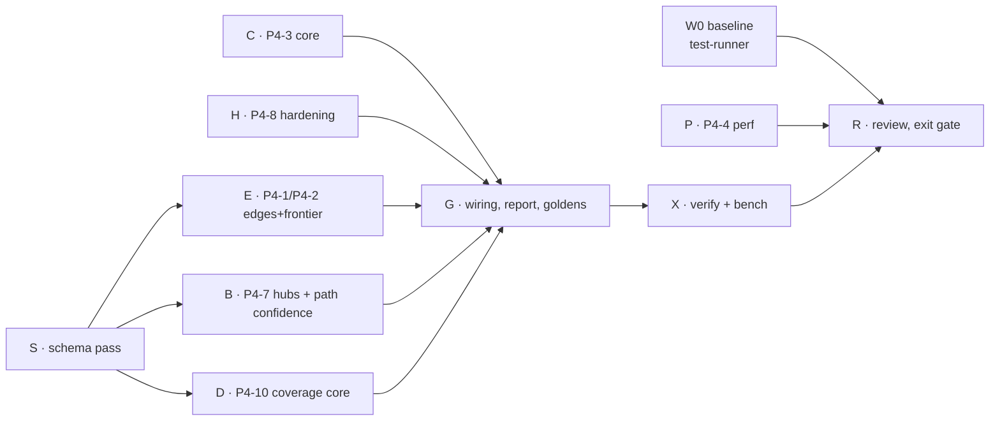

# Phase 4 Execution Plan · Confidence, Scale and Performance

Spec: Obsidian `03 Project Docs/Implementation Roadmap/Phase 4 - Confidence, Scale and Performance.md`
ClickUp list: `Phase 4 · Confidence and hardening` (1200440000083883) · Branch: `phase04` (from `223021d`)

**In scope:** P4-1, P4-2, P4-3, P4-4, P4-7, P4-8, P4-10
**Out of scope (deferred):** P4-5 (content-hash cache), P4-6 (monorepo → Phase 14), P4-9 (parallelism).
The p95 gate is measured and documented by P4-4, not optimized.

---

## 1. Decisions fixed before any worker starts

Workers follow these and do not reopen them. If a decision blocks a worker, it returns a question.

| # | Decision |
|---|---|
| D1 | All Phase 4 behaviour is **extended engine only**. The legacy engine and legacy goldens do not change. |
| D2 | All schema changes go in **one schema pass** (task S): optional fields under `2.1`, no version bump. No other task edits `contracts.ts` types, `evidence.schema.json` or `validator.ts`. |
| D3 | Edge confidence: `Relation.confidence?: 'proven' \| 'likely'`. Absent = `proven`. `unknown` is never an edge; it is a frontier item (D5). |
| D4 | Confidence rules, strict: **proven** = the checker resolves the symbol to exactly one declaration inside the repo. **likely** = resolved through an interface/abstract member or a symbol with more than one declaration, or a `REFERENCES` edge where the reference is a call argument (callback position). When unsure → `likely`. |
| D5 | Path confidence = weakest edge (`likely` < `proven`). Set on `ImpactPath.confidence` and on `EntityImpact.confidence` (weakest over its paths; `proven` when no paths). Computed in `impact.ts` from `relation.confidence ?? 'proven'`. When two relations join the same pair, the strongest one counts for that step. |
| D6 | Frontier item: `{ entityId, file, line, reason }`. `reason` ∈ `any_typed_call`, `computed_member_call`, `dynamic_require`, `dynamic_import`, `eval`, `function_constructor`, `jsx_prop_component`, `di_token`. Cap: 20 items per entity, then one `FRONTIER_CAPPED` info diagnostic per capped entity. Sorted by `file`, `line`, `reason`, `entityId`. |
| D7 | Evidence `frontier` lists only items whose `entityId` is a changed entity or in any blast radius. The total count over the whole repo goes into `coverage.frontierTotal`. |
| D8 | Hubs: a node whose direct fan-in ≥ `hubThreshold` (default 25) is a hub. Traversal records the hub and its direct dependents but does not expand beyond the hub. `blastRadius.hubs: [{ entityId, fanIn, reach }]` (`reach` = full reverse-reachable count within maxDepth, counted, not expanded into paths). `truncated: true` when any hub stopped expansion. Defaults: maxDepth 6 (existing `MAX_BLAST_DEPTH`), maxAffected 2000 (existing). CLI flags `--max-depth`, `--max-affected`, `--hub-threshold`. |
| D9 | Input limits are **input-size based only**. No wall-clock stop in this phase (CI job timeout covers it; documented as a limitation). Defaults: file > 2 MB → `FILE_TOO_LARGE`; NUL byte in first 8 KB → `BINARY_FILE`; invalid UTF-8 → `INVALID_ENCODING`; symlink leaving the repo or looping → `SYMLINK_SKIPPED`; more than 50 000 analyzable files or 500 MB total → `INPUT_LIMIT_EXCEEDED` (deterministic: keep the first N by sorted path). Each skip is one diagnostic with `file`, sorted. |
| D10 | The analyzer never executes target code. `compilerOptions.plugins` in the target tsconfig is ignored (the compiler API does not load them; a test proves it). |
| D11 | Non-TS change classes, first match wins, sorted by path: `DEPENDENCY_CHANGE` (`package.json`, lockfiles), `SCHEMA_CHANGE` (`*.prisma`, `*.sql`, `migrations/**`), `ENV_CONFIG_CHANGE` (`.env*`, `*.config.*`, `tsconfig*.json`, `*.yml`/`*.yaml`/`*.toml`/`*.ini` outside CI dirs), `CI_CONFIG_CHANGE` (`.github/**`, `.gitlab-ci.yml`, `.circleci/**`, `Dockerfile*`), `ASSET_ONLY` (images, fonts, media, `*.css`/`*.scss`), `OTHER`. One `warning` diagnostic per file with `file` set. `package.json` diffs list added/removed/changed dependency names and versions, sorted by name. These replace `OUTSIDE_SUPPORTED_SCOPE` in the extended engine. |
| D12 | Coverage: `DeterministicEvidence.coverage?: { byLanguage: CoverageRow[]; byDirectory: CoverageRow[]; skippedFiles: Array<{ file, reason }>; frontierTotal: number }`. `CoverageRow = { key, changedLines, attributedLines, ratio, frontierCount }`. `ratio` uses the same rounding as `attribution.ratio`. Skip reasons: `unsupported_language`, `generated`, `too_large`, `binary`, `parse_failure`, `invalid_encoding`, `symlink`. Directory = first path segment (`.` for root files). Rows sorted by key. |
| D13 | Every new array or map that reaches evidence is sorted (`deterministic.ts` `compareStrings`). |
| D14 | (Added after H.) Parser stack overflow depends on call-stack depth, so it is not a deterministic limit. Before parsing, a token scan measures bracket nesting depth; depth > 500 → skip as `parse_failure`. The `RangeError` catch in `source-snapshot.ts` stays as a last-resort safety net only. Snapshot reason `parse_failed` maps to evidence `parse_failure`. |

**Follow-ups from H for task G:** D14 pre-scan; map `parse_failed` → `parse_failure`; remove skipped files from `analyzedFiles`; apply limits to `getBaselineSource` reads in `analyze.ts:125`.

**P4-4 result (`docs/PERF_BASELINE.md`, M4 under heavy load):** 205k LOC → median 94.9 s, p95 101 s (gate not met). 75% of time is one `git show` spawn per base file (`repository.ts:321`). Parse + normalize is ~10 s. Decisions: P4-5 cache stays cut; P4-9 stays deferred; new task **F** batches base reads with a single `git cat-file --batch`. Bug to investigate (parent): a long linear import chain at 2k files crashes with `RangeError: Maximum call stack size exceeded`, surfaced only as `OPERATION_FAILED`.

**Follow-ups from D for task G:** coverage rows count changed lines only (frontier outside changed files counts only in `frontierTotal`, by design). Pass every changed file to `buildCoverage`, including skipped and non-TS ones, so they show as 0% attributed rows as well as in `skippedFiles`.

## 2. Code map (verified 2026-11-01 on `223021d`)

| Concern | Location |
|---|---|
| Pipeline | `packages/analyzer/src/analyze.ts` (origin filter :95-111, `OUTSIDE_SUPPORTED_SCOPE` :117-120, `BLAST_RADIUS_TRUNCATED` :176, attribution :199, envelope :204-226) |
| Contracts | `src/contracts.ts` (limits :9-13, `Relation` :56, `ImpactPath` :116, `EntityImpact` :128, `DiagnosticItem` :144) |
| Symbol resolution / edges | `src/technical-graph.ts` (`resolveSymbol` :210, CALLS :402-410, render/reference sites :336-375, `emit`/`addRelation` ~:217) |
| Traversal | `src/impact.ts` (`getBlastRadiusShortestPaths` :120-202, `buildImpact` :205-245) |
| Head reads | `src/source-snapshot.ts` (`readFile` :33, host :92) |
| Git file listing | `src/repository.ts` (`listFiles`, realpath :80-128) |
| File origin (P3-9) | `src/file-origin.ts` |
| CLI flags | `src/cli-options.ts` |
| Markdown report | `src/output.ts` |
| Goldens | `UPDATE_GOLDENS=1 npm test --workspace=@graphentra/analyzer` |
| Schema sync / full gate | `npm run sync:evidence-schema` · `npm run verify:all` |
| Real-repo bench | `npm run bench:fetch` / `bench:baseline` (`impactbench/`) |

## 3. Waves and agents

| Wave | Agent | Model | Owns (may edit) |
|---|---|---|---|
| W1 | W0 baseline | test-runner | none (report to scratchpad) |
| W1 | S · schema | sonnet-worker | `contracts.ts`, `evidence.schema.json`, `validator.ts`, synced schema copies, new `test/schema-phase4.test.ts` |
| W1 | P · P4-4 | sonnet-worker | new `tools/bench-perf.mjs`, root `package.json` (one `bench:perf` script), new `docs/PERF_BASELINE.md` |
| W1 | C · P4-3 core | sonnet-worker | new `src/non-ts-changes.ts` + test only |
| W1 | H · P4-8 | sonnet-worker, effort higher | new `src/input-limits.ts`, `source-snapshot.ts`, `repository.ts`, new tests; hostile fixture generated in a temp dir at test time (no 50 MB file committed) |
| W2 | E · P4-1 + P4-2 | sonnet-worker, effort higher | `technical-graph.ts` + new tests |
| W2 | B · P4-7 + D5 | sonnet-worker | `impact.ts`, `cli-options.ts`, `cli.ts` + new tests |
| W2 | D · P4-10 core | sonnet-worker | new `src/coverage.ts` + test only |
| W3 | G · wiring | sonnet-worker, effort higher | `analyze.ts`, `output.ts`, `index.ts`, goldens, new fixtures (dynamic patterns, mixed languages, hub) |
| W4 | X · verify | test-runner | none |
| W4 | R · review | parent | fixes; ClickUp + Obsidian status; tag `phase-4-complete` |

H owns `source-snapshot.ts`/`repository.ts` and returns the skip list from the snapshot; it does **not** edit `analyze.ts` (G wires the diagnostics). W2 starts after S is merged. G runs alone because everything lands in `analyze.ts`.

**Worktree protocol (every writer):** `isolation: "worktree"`. First command: `git reset --hard <phase04 HEAD sha>` (worktrees start from `origin/main`), then `npm ci`. Commit inside the worktree as `feat(analyzer): ... (P4-n)`. The parent integrates with `git cherry-pick`, removes the worktree and its branch, then runs a quick `npm test --workspace=@graphentra/analyzer`; the full `verify:all` goes to test-runner.

## 4. Exit gate (from the spec)

- [ ] Every edge in extended evidence has an explicit or defaulted confidence; the report groups impacts by it
- [ ] Frontier list appears for the dynamic-call fixture; sorted and deterministic
- [ ] Non-TS changes give typed diagnostics (deps, schema, env)
- [ ] p95 < 90 s on ~200k LOC, or a documented measurement and plan (`docs/PERF_BASELINE.md`)
- [ ] Hostile fixture runs to a valid, bounded result that lists each skip
- [ ] Coverage table per language/directory in the summary
- [ ] ImpactBench numbers not lower than the W0 baseline
- [ ] `verify:all` green; tag `phase-4-complete`
