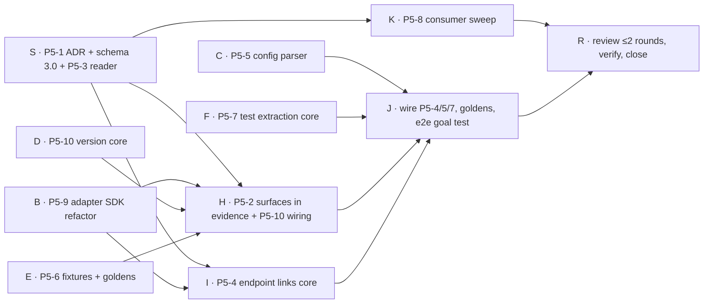

# Phase 5 Execution Plan · Surfaces and Tests in Evidence

Spec: Obsidian `03 Project Docs/Implementation Roadmap/Phase 5 - Surfaces and Tests in Evidence.md`
ClickUp list: `Phase 5 · Surfaces and tests` (1200440000083884) · Branch: `phase-05` (from `dev` @ `90b86dd`)

**In scope:** P5-1 … P5-10 (MVP cuts below). **Deferred:** P5-11 (→ Phase 12) and its exit-gate line.

**MVP cuts (from the spec):** P5-6 Next.js + Express only · P5-10 Next.js only (Express version read, not rule-switched) · P5-9 modules + interface + one declarative adapter (Express) · P5-7 static imports + Playwright `goto` / Cypress `visit` · P5-5 criticality + ignores (+ manual surface→handler mapping, + test dirs).

---

## 1. Decisions fixed before any worker starts

Workers follow these and do not reopen them. A worker blocked by a decision returns a question.

| # | Decision |
|---|---|
| D1 | Schema 3.0 is **opt-in** until the exit gate: `AnalyzeOptions.evidenceSchema?: '2.1' \| '3.0'` (default `'2.1'`), CLI `--schema 3.0`. Only the **extended** engine can emit 3.0 (legacy + `--schema 3.0` → `INVALID_OPTIONS` error). Legacy (2.0) and extended 2.1 output and goldens stay **byte-identical**. |
| D2 | 3.0 = 2.1 + new optional fields. Nothing in 2.1 is removed or renamed, so a 3.0 document is a 2.1 document plus surfaces/tests. The breaking part is only the version string and the new identity inputs. |
| D3 | Surface kinds (sorted, all accepted by schema; MVP emits only `api_endpoint`, `ui_route`): `api_endpoint, cli_command, graphql_operation, library_export, mobile_screen, queue_consumer, rpc_method, scheduled_job, serverless_function, ui_route, webhook`. |
| D4 | `SurfaceNode = { id, kind, route, method?, file, line, handlerEntityIds: string[] (sorted, unique), framework?: string /* "nextjs@14" */, adapter: { id, version }, confidence: 'proven'\|'likely', source: 'detected'\|'config', criticality?: string }`. IDs keep today's form: `ui:<route>`, `api:<METHOD> <route>`. Presentation extras (uiText, textKeys, navigation, access, e2e flows) stay in `application-map.json` only, **never** in evidence. |
| D5 | `SurfaceEdge = { from, to, type, confidence, via? }`, `type ∈ CALLS_ENDPOINT, SURFACE_HANDLED_BY, TEST_COVERS` (sorted). Directions: `SURFACE_HANDLED_BY` surface→entity; `CALLS_ENDPOINT` entity→api surface; `TEST_COVERS` test→entity or test→surface, `via ∈ 'goto'\|'import'`. Evidence keeps them in `surfaceEdges`, **not** in `technicalGraph.relations` (the 2.1 graph stays unchanged). |
| D6 | `TestNode = { id: "test:<file>#<suite> > <name>", file, line, name, framework: 'cypress'\|'jest'\|'node-test'\|'playwright'\|'unknown'\|'vitest' }`. One node per `it/test` block (suite path joined with ` > `). Duplicate IDs get `#2`, `#3` suffix in source order. |
| D7 | Impact reaches surfaces by one reverse BFS over the union graph: entity relations + reversed `SURFACE_HANDLED_BY` (handler → surface) + reversed `CALLS_ENDPOINT` (api surface → calling entity). Depth limit `MAX_SURFACE_REACH_DEPTH` (10). Output per impact: `affectedSurfaces?: Array<{ surfaceId, depth, path: string[] /* changed entity … surface */, confidence }>`, sorted by depth then surfaceId, absent when empty. Path confidence = weakest of edge confidences on the path (same rule as Phase 4 D5). |
| D8 | Top-level evidence 3.0 fields (all sorted by `id` or `from\|type\|to`, D13 of Phase 4): `surfaces`, `surfaceEdges`, `tests`, `testMapping?: { basis: 'static-reach', testsToRun: Array<{ testId, reaches: string[] }>, uncoveredSurfaces: string[] }`, `config?: { file: 'graphentra.yml', sha256 }`, `adapters?: Array<{ id, version, framework?, detectedVersion?, certified: boolean }>`. |
| D9 | Endpoint link confidence (P5-4): literal URL + literal method matching exactly one endpoint → `proven`; template literal / param match / wrapper (`api.get('/x')`) / base-URL constant → `likely`; anything else → frontier item with new reason `dynamic_endpoint_url` (added to `FRONTIER_REASONS`, sorted). More than one matching endpoint → `likely` edge to each. |
| D10 | Surface extraction failure never blocks evidence: on throw, evidence 3.0 has `surfaces: []`, `surfaceEdges: []` and a `SURFACE_EXTRACTION_FAILED` warning diagnostic. Same for test extraction (`TEST_EXTRACTION_FAILED`). |
| D11 | Framework version (P5-10): read from `package.json` (`dependencies` / `devDependencies`) and lockfile (`package-lock.json` v2/v3, `pnpm-lock.yaml`, `yarn.lock`) — never install, never execute. Resolved lockfile version wins over the declared range. Certified set: `next` majors 13, 14, 15; `express` majors 4, 5. A detected framework with unknown or uncertified major still runs; its surfaces get `confidence: 'likely'` and one `FRAMEWORK_VERSION_NOT_CERTIFIED` info diagnostic per adapter. Next.js: `app/` router rules only when major ≥ 13. Applied per surface: the version comes from the nearest `package.json` that names the framework (the manifest that gated the adapter for that file) and that workspace's lockfile entry. |
| D12 | `graphentra.yml` (P5-5) at the analyzed project root, optional. Keys: `version: 1`, `criticality: { <surfaceId or glob>: critical\|high\|normal\|low }`, `ignore: [globs]` (merged into excludePaths), `tests: [globs]` (treat as test dirs), `surfaces: [{ id, kind, route, method?, handler: "<entityId>" }]` (source `config`, confidence `proven`). Unknown keys → `CONFIG_UNKNOWN_KEY` warning with `file:line`. Invalid → `CONFIG_INVALID` **error diagnostic**, config ignored, analysis continues. The file's sha256 enters identity via `evidence.config`. Parser: `yaml@2.6.1` (exact pin, analyzer dependency). |
| D13 | Identity (P5-3): `computeDeterministicEvidenceIdentity` orders every new array; for 2.x documents the payload is unchanged, so 2.x identities do not change. |
| D14 | One reader: `readEvidence(doc: unknown): NormalizedEvidence` in `src/evidence-reader.ts`, exported from the package. It validates (2.0, 2.1, 3.0), then returns a view with `surfaces`, `surfaceEdges`, `tests` always present (empty arrays for 2.x). `testMapping` is optional and never invented: it is present only when the document has one, and `testMappingAvailable: boolean` says so (always false for 2.x; false for a 3.0 document whose surface or test extraction failed, D10). Consumers (P5-8) read through it. |
| D15 | Adapter SDK (P5-9): `src/adapters/<id>/index.ts`, registry sorted by adapter id. Interface: `{ id, version, frameworks: string[], detect(ctx): Detection, surfaces(ctx): DetectedSurface[] }` plus a shared `AdapterContext` holding the TS program, checker, helpers. Step 1 is a pure move: `modern-app-application-map.extended.json` and the app-map tests stay byte-identical. Adapter ids: `express-declarative`, `nestjs`, `nextjs-app-router`, `nextjs-pages-router`, `nextjs-route-handler`, `react-router`, `route-config`, `http-router` (Koa/Fastify/Hono via the generic router rule). Client-request detection moves to `src/adapters/http-client.ts` (P5-4 owns it after the move). |
| D16 | Review gate: a fresh-context reviewer scores the phase 1–10 on correctness, determinism, 2.x compatibility, and tests. **Pass = score ≥ 8 and no high-severity finding.** At most **2** fix rounds; after that, remaining findings are reported, not looped on. |

## 2. Code map (verified 2026-11-09 on `90b86dd`)

| Concern | Location |
|---|---|
| Pipeline + evidence envelope | `packages/analyzer/src/analyze.ts` (envelope :292-306, `buildApplicationMap` :385-397, `emptyApplicationMap` :376) |
| Contracts | `src/contracts.ts` (versions :4-6, `Relation` :56, `EntityImpact` :149, `FRONTIER_REASONS` :172, `DeterministicEvidence` :257, `AnalyzeOptions` :294) |
| Identity | `src/deterministic.ts` `computeDeterministicEvidenceIdentity` :21 |
| Validator | `src/validator.ts` (version check :171, 2.1 switch :174) |
| JSON schema + sync | `packages/analyzer/evidence.schema.json` → `apps/visualizer/schema/` (`npm run sync:evidence-schema`, check `verify:schema`) |
| App map (1,190 lines) | `src/application-map.ts` (types :21-108, `extractApplicationMap` :174, surface IDs :903, `findSurfacesForEntity` :1158), `application-map-ast.ts` (`routeMatcher` :149), `application-map-e2e.ts` |
| Fixtures | `packages/analyzer/test/fixtures/web-app` (Next-ish + Express + Prisma), `fixtures/modern-app`, goldens `packages/analyzer/test/golden/` (`UPDATE_GOLDENS=1`) |
| Consumers | `packages/reporting/src/{context-pack,qa-evidence,report-generator,context-generator}.ts`, `apps/visualizer/src/visualize.ts`, `apps/ci-runner/src/idempotency.ts`, `tools/server.ts`, `tools/report.ts`, `tools/publish-report.ts` |
| Gate commands | `npm run typecheck`, `npm test`, `npm run verify:schema`, `npm run verify:boundaries` |

## 3. Waves and agents

| Wave | Agent | Tasks | Owns (may edit) |
|---|---|---|---|
| W1 | S | P5-1, P5-3 (core) | `contracts.ts`, `validator.ts`, `deterministic.ts`, `evidence.schema.json`, visualizer schema copy, new `src/evidence-reader.ts`, `index.ts` (export only), new `docs/adr/ADR-0006-evidence-schema-3.0.md`, new `test/fixtures/evidence-3.0/*.json`, new `test/schema-3-0.test.ts` |
| W1 | B | P5-9 | `application-map.ts`, `application-map-ast.ts`, `application-map-e2e.ts`, new `src/adapters/**`, new `test/adapters/*.test.ts`, new `docs/adapters/HOW_TO_WRITE_AN_ADAPTER.md` |
| W1 | C | P5-5 (core) | new `src/config.ts`, new `test/config.test.ts`, analyzer `package.json` + lockfile (`yaml` only) |
| W1 | D | P5-10 (core) | new `src/framework-version.ts`, new `test/framework-version.test.ts` |
| W1 | E | P5-6 | new `packages/analyzer/test/fixtures/frameworks/**`, new `test/adapter-certification.test.ts`, new `test/golden/adapters/**`, new `docs/adapters/CAPABILITIES.md` |
| W1 | F | P5-7 (core) | new `src/test-mapping.ts`, new `test/test-mapping.test.ts` |
| W2 | H | P5-2, P5-10 wiring | `analyze.ts`, `index.ts`, `cli-options.ts`, `cli.ts`, `application-map*.ts`, `src/adapters/**` except `http-client.ts`, new `src/surface-evidence.ts`, new `src/surface-impact.ts`, goldens, new tests |
| W2 | I | P5-4 (core) | `src/adapters/http-client.ts`, new `src/endpoint-links.ts`, new `test/endpoint-links.test.ts` |
| W2 | K | P5-8 | `packages/reporting/**`, `apps/**`, `tools/server.ts`, `tools/report.ts`, `tools/publish-report.ts`, `test/integration/**` |
| W3 | J | wiring P5-4, P5-5, P5-7 | `analyze.ts`, `surface-evidence.ts`, `surface-impact.ts`, goldens, new `test/phase5-goal.test.ts` |
| W4 | R | review + verify | reviewer (fresh context) → parent fixes; test-runner runs the gate |

**Protocol (every writer):** works in this checkout (no worktree, see memory: worktree reset fails in the sandbox), edits only its owned files, does **not** commit and does not run `git stash`/`checkout`/`reset`. The parent commits each agent's files by path as `feat(analyzer): … (P5-n)`. Agents run only their own tests plus `npm run typecheck --workspace=@graphentra/analyzer`.

## 4. Exit gate (from the spec, MVP)

- [ ] Every certified adapter (Next.js, Express) has fixture + golden + capability table
- [ ] Adapters live behind the SDK interface (P5-9); each surface records adapter id + version
- [ ] Schema 3.0 surface `kind` list is general (not web-only); framework versions detected (P5-10)
- [ ] 2.x evidence still readable everywhere; 3.0 opt-in (`--schema 3.0`)
- [ ] The goal sentence is produced deterministically on the web-app fixture: affected page + endpoint, tests to run, uncovered surface
- [ ] typecheck, test, verify:schema, verify:boundaries green; reviewer score ≥ 8
- [ ] ImpactBench surface recall / partner-PR review: measured after merge (needs real repos; not in this branch)
- [ ] P5-11 line: deferred to Phase 12
