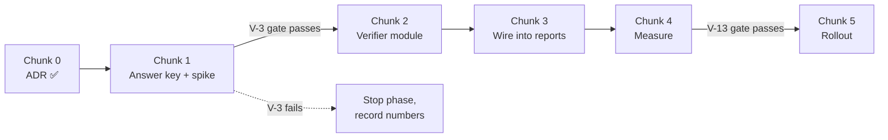

# Phase V · Verified Report: Implementation Chunks

**Source of truth:** the knowledge base note *Phase V - Verified Report (Decisions API)* and **ADR-0011 Report Verifier - Decisions API After Generation** (both in the Obsidian vault, `03 Project Docs/`). This file groups the Phase V tasks into chunks of similar work, so each chunk can land as one PR or one work session.

**Goal of the phase:** after the LLM writes the QA report, a cheap Decisions API verifier checks that every changed behaviour is covered, that QA checks use the triggering input, and that claims match the evidence. Gaps get one targeted repair round, then a deterministic "Not covered" list. Off by default until measured on ImpactBench corpus-32.

**Rules that apply to every chunk (from ADR-0011):**
- The verifier runs after generation, in `packages/reporting` only. Never in `packages/analyzer`; `npm run verify:boundaries` must keep passing.
- Recall first: refusal, error, timeout, missing answer or a near-threshold score means *not covered*.
- The verifier only adds (a repair round, a "Not covered" line). It never deletes or hides a finding.
- OpenAI Decisions first, Google only as a comparison. Both behind one `DecisionClient` interface.
- Opt-in flag, off by default. With the flag off, output is byte-identical and no network call is made.

## Overview

| Chunk | Tasks | Kind of work | Where | Ends with |
|---|---|---|---|---|
| 0 · Decision | V-0 ✅ | ADR | Obsidian vault | ADR-0011 written (Proposed) |
| 1 · Answer key and spike | V-1 ✅, V-2 ✅, V-3 ✅ (+ V-18) | Eval data and spike script, no product code | `eval/corpus32-lookup-tool` branch: `impactbench/`, `tools/` | **Gate:** vendor and threshold, or stop the phase |
| 2 · Verifier module | V-4, V-5, V-6, V-7 (+ V-19) | New library code, off by default, offline tests | `packages/reporting` (new files only) | One PR; tests and boundary check pass offline |
| 3 · Wire into reports | V-8, V-9, V-10 | Changes to existing report generation | `llm-client.ts`, `impactReportSchema`, `tools/report.ts` | One PR; `--verify` works end to end, no change without it |
| 4 · Measure | V-11, V-12, V-13 | Harness variant, benchmark run, write-up | eval branch, `impactbench/eval/REPORT.md`, ADR-0011 | **Gate:** flip default, keep opt-in, tune, or drop |
| 5 · Rollout | V-14, V-15, V-16 (+ V-17) | Backend config, dashboard, feedback loop | backend, dashboard, data-processing review | Real reports show verifier signals |

**Critical path:** V-1 → V-2 → V-3 → V-4/V-5 → V-6 → V-8 → V-9/V-10 → V-11 → V-12 → V-13.

---

## Chunk 1 · Answer key and spike

**Why together:** all three are measurement work on the eval branch, with no product code. They answer one question: is the verifier accurate enough to build (E5: recall ≥ 0.90 for "not covered", precision ≥ 0.60)?

**Inputs (on `eval/corpus32-lookup-tool`):**
- Reports: `impactbench/eval/data-v2/runs.jsonl` (31 rows, 1 base run, `gpt-6-luna`), with judge fields `catch`, `explained`, `area`, `why`.
- Ground truth: `impactbench/corpus/d0-corpus.json` (32 commits, affected entities with roles).
- Evidence (`removedCode`, `addedCode`): regenerate with `tools/impactbench-report-eval.mts evidence`.

| ID | Task | Size | Depends on | Done when |
|---|---|---|---|---|
| V-1 | Hand-labelled verifier set: ~60 coverage pairs, ~50 triggering-input pairs, ~40 faithfulness sentences, each with the compact verifier input. Saved as JSONL. | M | — | File exists, every item has a label and a one-line reason, both classes appear for each question kind |
| V-2 | Spike script in `tools/`: send the set to OpenAI Decisions, Google Decisions and the current generative judge. Report recall and precision per threshold (0.3 to 0.7), Brier score, 5-bin reliability table, cost, p50/p95 latency. | M | V-1 | One command produces the table; a full run costs under $1 |
| V-3 | Gate: choose vendor and threshold where recall ≥ 0.90 and precision ≥ 0.60. If none, stop the phase and record the result in ImpactBench notes. | S | V-2 | Decision and threshold written into ADR-0011 (status → Accepted or Rejected) |
| V-18 *(optional, later)* | Decisions judge for ImpactBench, only at ≥ 90 % agreement with the current judge. Reuses the V-2 comparison. | S | V-2 | Agreement measured; adopted only above 90 % |

**Open question for V-2:** does OpenRouter proxy `/v1/decisions`? If not, the verifier needs a direct `OPENAI_API_KEY`.

---

## Chunk 2 · Verifier module (off by default)

**Why together:** all new code in `packages/reporting`, behind the flag, testable offline with a fake client. Low risk: nothing existing changes. Start only after the V-3 gate passes.

| ID | Task | Size | Depends on | Done when |
|---|---|---|---|---|
| V-4 | `DecisionClient` interface (`decide(input, questions) → answers`), OpenAI adapter, fake client. Timeouts, same transport retry rules as `llm-client.ts`, batching above 400 questions, shared input prefix for prompt caching. Direct OpenAI key. | M | V-3 | Unit tests with the fake pass; one live call works behind an env flag |
| V-5 | Question builders: pure functions from evidence impacts + finished report to the **two** question sets (U1 coverage, U3 faithfulness; U2 was rejected at V-3), with a short BEFORE-state context for U3 "now/new" claims, using the compact input. Test entities excluded from coverage questions. | M | V-4 | Snapshot tests show stable questions for the fixture project; no question exceeds the context |
| V-6 | Verdict policy: probability → covered / not covered at the V-3 threshold. Refusal, error, timeout and missing answers → not covered. Output: a `verification` block (entity, score, verdict). | S | V-5 | Tests cover every answer type, including refusal and a dropped answer |
| V-7 | Offline tests and boundary check: reporting tests use the fake client only; analyzer gains no dependency. | S | V-6 | `npm test`, `npm run typecheck`, `npm run verify:boundaries` pass without network |
| V-19 *(optional, later)* | Google adapter for calls above 400 questions, behind the same interface. | S | V-4 | Adapter passes the same contract tests as the OpenAI adapter |

**Parallel option:** V-5 has no dependency on the client code, so it can be written alongside V-4 (disjoint files).

---

## Chunk 3 · Wire into report generation

**Why together:** these change existing code paths (`llm-client.ts`, report schema, CLI). This is the PR that needs the careful review.

| ID | Task | Size | Depends on | Done when |
|---|---|---|---|---|
| V-8 | Targeted repair round: if the verifier flags gaps, the writer gets one more attempt with the named gaps. Shares the attempt cap with the existing semantic retry. Verifier runs again on the repaired report. | M | V-6 | A test where the fake verifier flags one entity shows exactly one repair call and a re-check |
| V-9 | Deterministic "Not covered" list: entities still flagged after the repair are added by code (not the LLM). Additive schema change (ADR-0005), so old readers keep working. | M | V-8 | A test where the LLM drops an entity twice shows it in the final report; no item is ever removed |
| V-10 | Trace, usage and CLI flag: log verifier calls, tokens, cached tokens, latency and scores via `logLLMTrace`; return verifier usage in the report result; add `--verify` to `tools/report.ts` (same switch as `GRAPHENTRA_VERIFY_REPORT=1`). | S | V-8 | A local run with `--verify` prints verifier usage; a run without it is unchanged |

**Coordinate with Phase N, N-5:** N-5 produces the same deterministic "Also affected / Not covered" list. Whichever lands first owns the schema field; the other reuses it.

---

## Chunk 4 · Measure on ImpactBench

**Why together:** one experiment: build the harness variant, run it, decide. Same eval branch as Chunk 1. The judge and report model stay fixed between base and verify.

| ID | Task | Size | Depends on | Done when |
|---|---|---|---|---|
| V-11 | Harness variant `verify`: meter verifier and repair cost separately; write the M3 silent-drop audit per report. | M | V-10 | A 3-commit smoke run writes rows with `usage.verifier` and the audit columns |
| V-12 | Base vs verify: 31 commits × 3 runs each, paired per-commit table, E1 to E7, M5 noise review, in a `REPORT.md` section. | M | V-11 | Section exists with every expectation marked met or not met |
| V-13 | Decision: if E1, E3, E4, E5 pass and E6, E7 are within budget, flip the default on. If only E3 passes, keep opt-in as the N-5 gate. If E1 drops or E4 rises, drop or rework. | S | V-12 | Decision written in ADR-0011 and the default matches it |

**Targets (data-v2 baseline):** E1 catch ≥ 13/31 (from 9/31) · E2 explain ≥ 15/31 (from 12/31) · E3 zero silent drops · E4 invalid ≤ 3/31 · E5 recall ≥ 0.90, precision ≥ 0.60 · E6 ≤ +35 % cost, ≤ +50 % median time · E7 ≤ +1 QA check per report, "Not covered" ≤ 3 items in 90 % of reports.

---

## Chunk 5 · Production rollout

**Why together:** all outside the report library: config, data-processing review, dashboard, feedback. Start only after the V-13 gate.

| ID | Task | Size | Depends on | Done when |
|---|---|---|---|---|
| V-14 | Backend config: OpenAI key and threshold in backend config; data-processing review (ZDR where eligible). | S | V-13 | Config in place; review recorded |
| V-15 | Dashboard signals: coverage scores, repair rate, "Not covered" count, refusals, verifier cost and latency (M6). | M | V-14 | Dashboard shows repair rate and "Not covered" count for real runs |
| V-16 | Feedback loop: QA-reported misses go into the labelled set; threshold re-checked monthly. | S | V-15 | First monthly re-check recorded |
| V-17 *(optional, later)* | Risk triage score to order the payload under a size budget (U4). Never drops evidence. | M | V-13 | Payload ordered by score; no evidence dropped |

---

## Status

| Chunk | Status |
|---|---|
| 0 · Decision | ✅ ADR-0011 written; **Accepted at V-3 (2026-11-17)** for U1 + U3 |
| 1 · Answer key and spike | ✅ done 2026-11-17 (PR #20). E5 passes for U1 + U3 with OpenAI Decisions at t=0.7: recall 92 %, precision 92 %, deterministic. U2 rejected. Results in `impactbench/verifier/history/`. |
| 2 · Verifier module | ✅ V-4 to V-7 on `feat/phase-v-verifier-module` (U1 + U3, threshold 0.7). |
| 3 · Wire into reports | ✅ V-8 to V-10 on `feat/phase-v-wire-reports` (stacked on Chunk 2). `review` hook in `generateImpactReport` (repair shares the 2-attempt cap; an unusable repair keeps the first report), `createReportVerifier` in `verifier/verified-report.ts`, optional `notCovered` on the report (owns the field for N-5), `--verify` / `GRAPHENTRA_VERIFY_REPORT=1`, `verifier.completed` / `verifier.finished` traces. Next: V-11. |
| 4 · Measure | ✅ V-11 to V-13 (2026-11-19). Base vs verify, 31 × 3: catch flat (10 → 11 of 31), 0 silent drops in 1,578 entities, +82 % writer prompt tokens, +44 % time, flag precision 28 %. Results in `impactbench/eval/REPORT.md`, baseline data in `impactbench/eval/data-v3/`. **Decision (ADR-0011):** default stays off; the V-8 repair round is removed (V-13a done: no `review` hook, one verifier pass, `ReportVerification` drops `passes` / `repairRequested` / `repairAccepted`, `verifier.finished` trace merged into `verifier.completed`). V-13b done: deterministic noise filter (`verifier/behaviour.ts`, `planCoverage`): skip changes with no runtime effect (verdict `skipped`), fold `A>b` inner functions into their outermost changed ancestor. Offline replay: 13/13 real gaps still asked, 21/34 noise flags removed, no ground-truth bug entity skipped, coverage questions −25 %. V-13c done: 12-commit check in `data-v4/` (REPORT.md "after V-13a/b"): 0 silent drops, time and writer tokens back to base, verifier tokens −61 %, 18/19 trivial flags gone; list length (E7) still too long on big refactors. V-13d done: `notCoveredLines` groups a list of more than 3 items per file, naming every change (data unchanged). Re-scored on `data-v4`: max 39 → 7 lines, ≤ 3 lines in 16 of 35 reports. E7 at 90 % is still not met: the remaining lists are spread over 4–6 files. Open: set E7 to "≤ 7 lines" or cut false flags. V-13e done: after the verifier, one LLM call (`verifier/plain-checks.ts`) rewrites the gaps as plain QA checks, and gaps with no valid check stay listed by code name for a developer (never dropped). Offline on 33 `data-v4` reports: 411 gaps → 103 checks, $0.02 total, median 41 s per report, 0 errors (REPORT.md, `data-v4/plain-checks.md`). Graded by an independent judge: 76/103 accurate, 2 real errors confirmed by hand. Recall issue: 64/359 claimed gaps are not really tested by their check and get hidden. V-13f done: the developer list always names every gap (0 hidden, by construction); the prompt rules for removed code, honest merging and exports show no measurable gain (judge: wrong 13 → 13, accurate 76 → 76 of 112). Next if pursued: hand-label about 30 checks to get a judge we can trust. |
| 5 · Rollout | ⬜ waits for V-13c |
